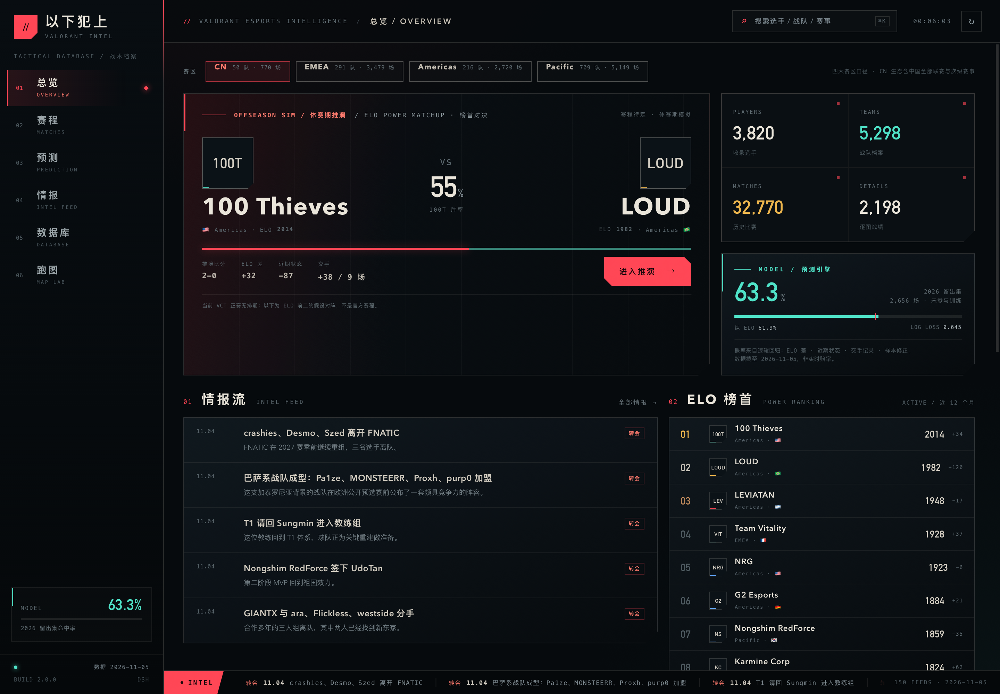
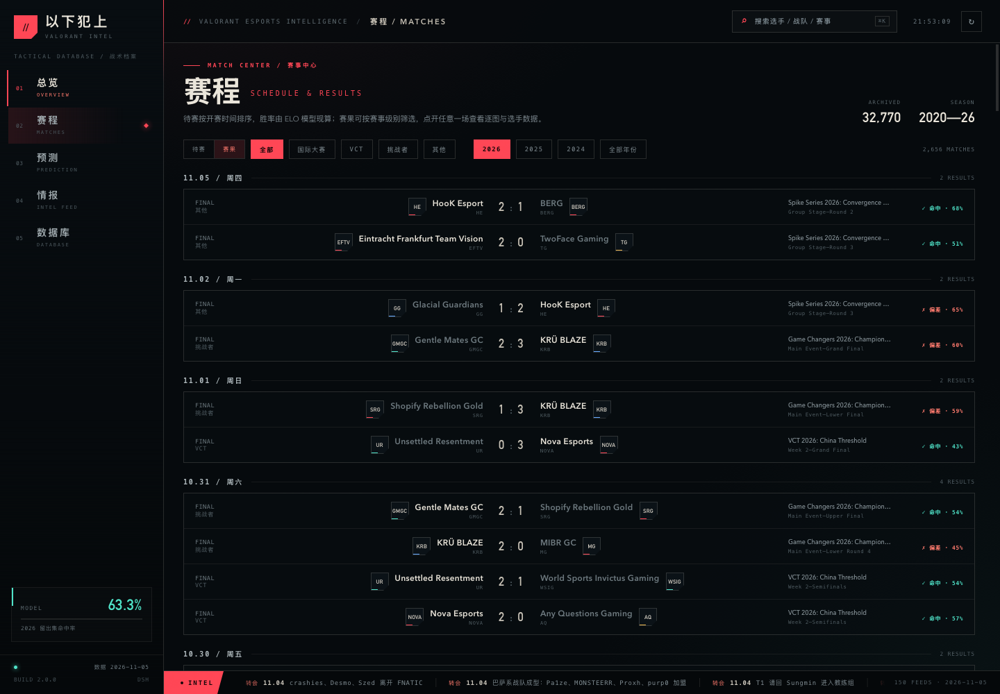
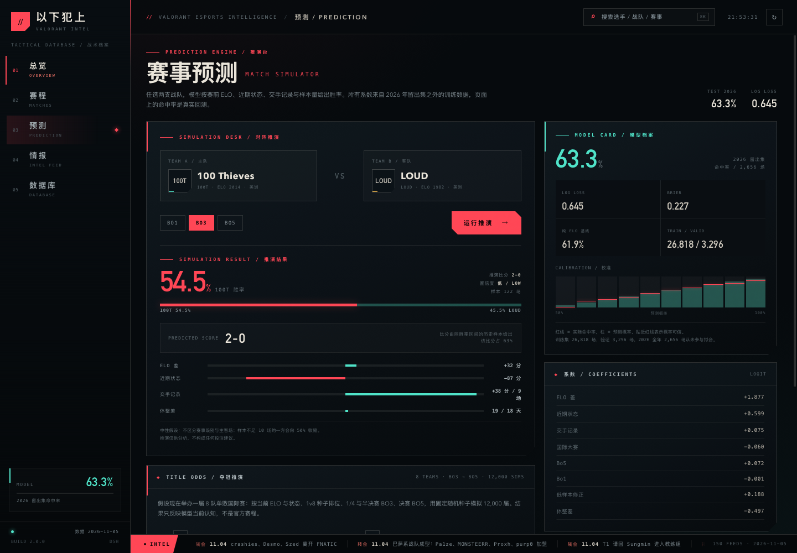
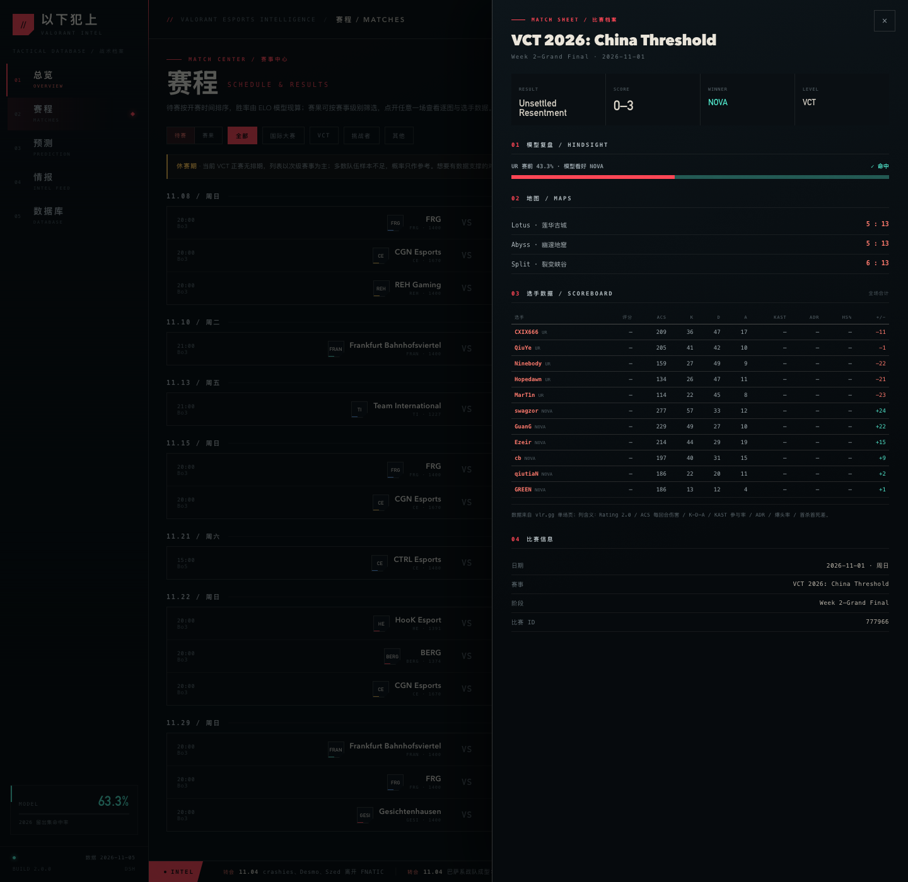
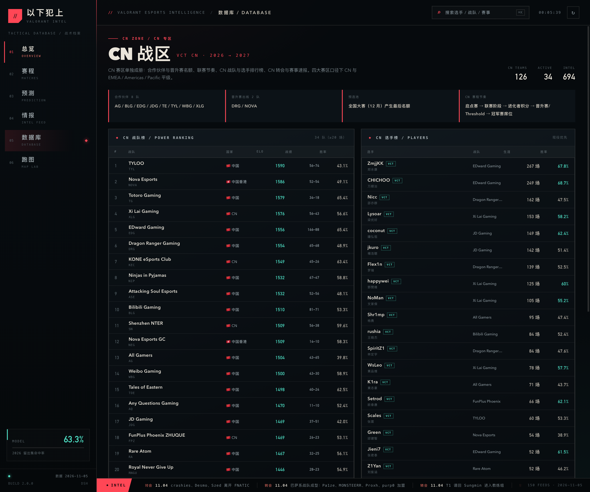
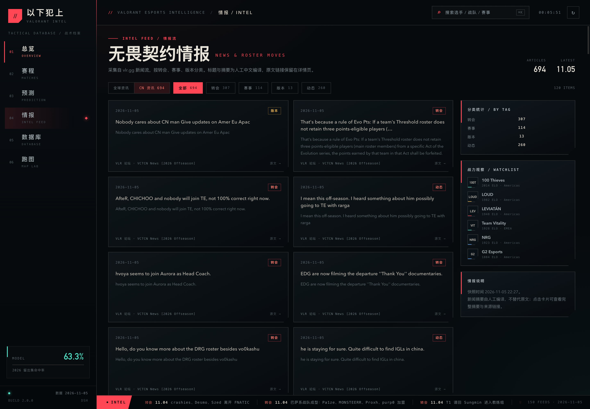
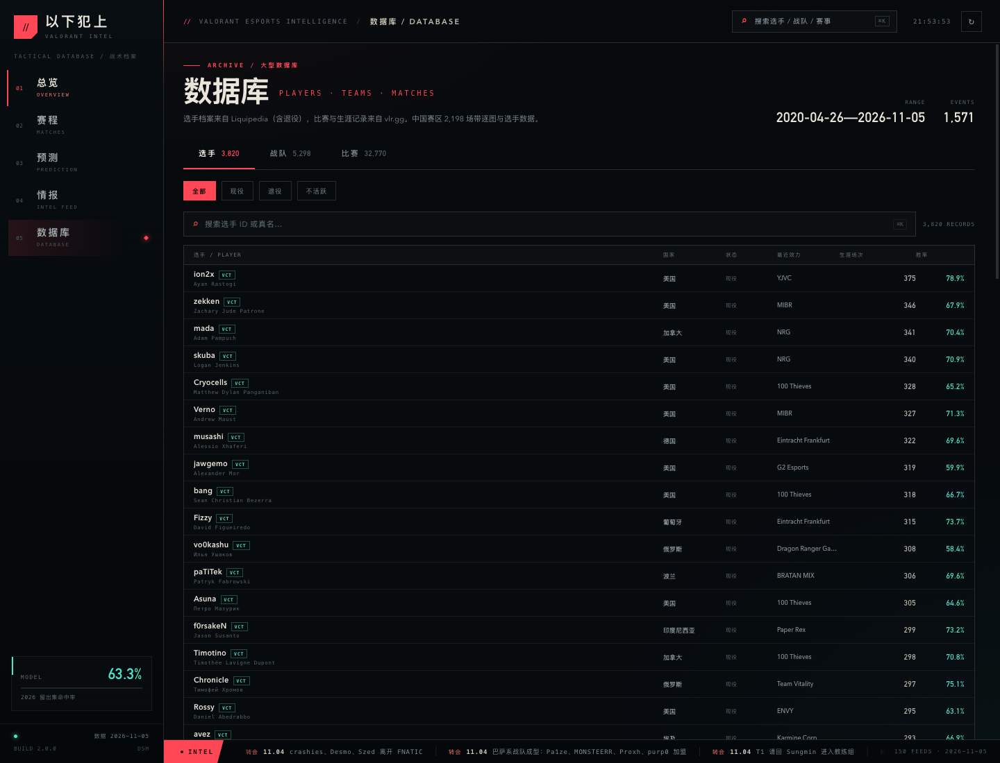
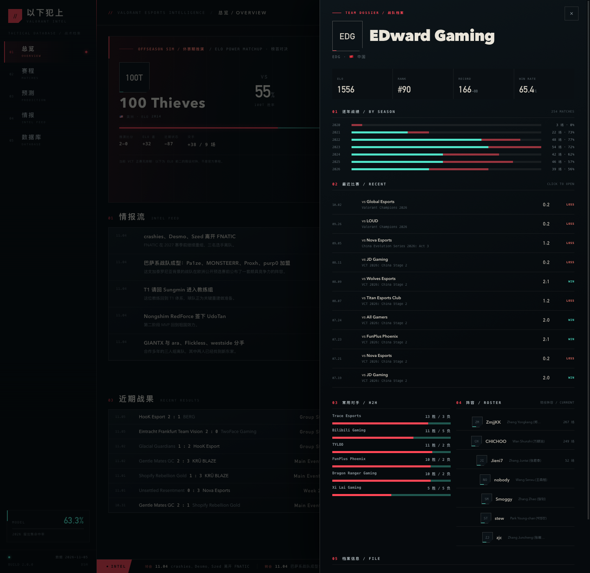
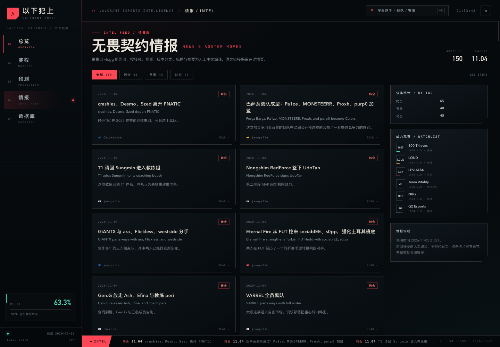
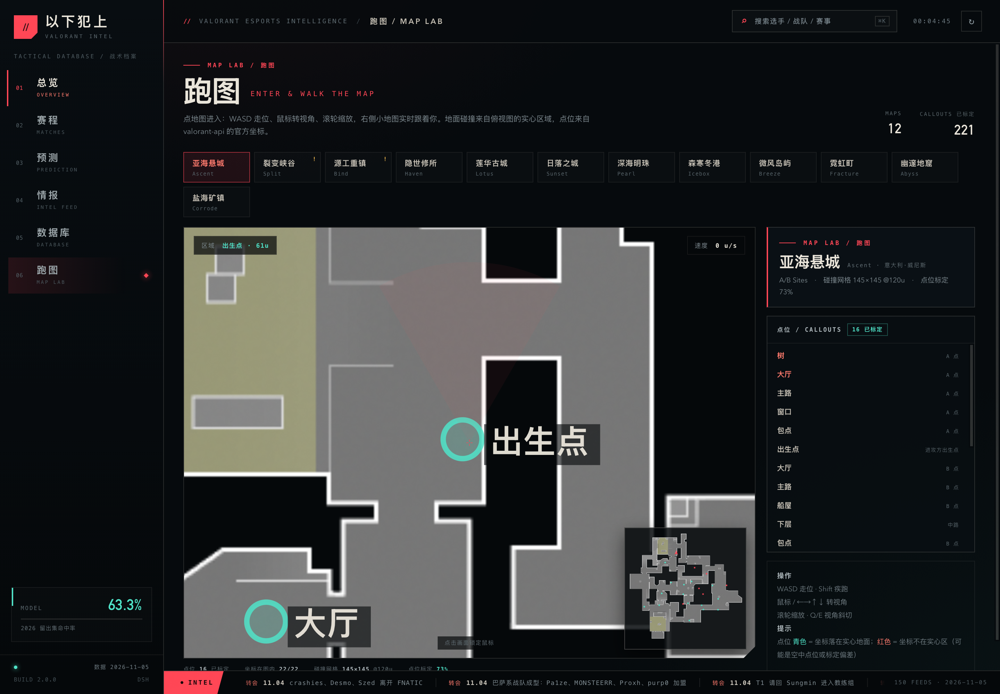

# 以下犯上 · VALORANT 情报终端
一块离线可查的《无畏契约》赛事情报终端：3,820 名选手 / 5,298 支战队 / 33,242 场比赛的数据库，加一个带真实回测的赛事预测模型（2026 留出集 63.3%），macOS 原生 App + 纯静态网页两形态。

> 从 WorkBuddy 的《以下犯上》VCT CN 档案库接手，保留全部历史数据，
> 用《源能行动》的战术终端视觉重建前端，并加上赛事预测与新闻流。



---

## 功能

| 模块 | 状态 |
|---|---|
| 赛事预测（ELO + 状态 + 交手，逻辑回归） | ✅ 2026 留出集 63.3%，可复现 |
| 夺冠推演（8 队单败蒙特卡洛） | ✅ |
| 新闻流（150 条快照 + 原生 App 内在线更新） | ✅ |
| 选手 / 战队 / 比赛数据库（3,820 / 5,298 / 33,242） | ✅ |
| 逐图与选手计分板（2,198 场） | ✅ |
| 当前阵容（38 支主要战队） | ✅ |
| macOS 原生 App + dmg | ✅ |
| 赛区四分类 CN / EMEA / Americas / Pacific | ✅ |
| CN 专区 + CN 资讯（694 条） | ✅ |
| 跑图 Map Lab（13 张，12 张点位已标定） | ✅ |
| iOS 版 | ⬜ 未做 |
| 地图池 / BP 级模型 | ⬜ 未做（路线图） |

五个页面：**总览 / 赛程 / 预测 / 情报 / 数据库**。逐页说明见 [`使用说明.md`](使用说明.md)。

---

## 截图

| 总览 | 赛程 |
|---|---|
|  |  |

| 预测 | 单场复盘 |
|---|---|
|  |  |

| CN 专区 | CN 情报 |
|---|---|
|  |  |

| 数据库 | 战队 |
|---|---|
|  |  |

| 情报流 | 跑图 Map Lab |
|---|---|
|  |  |

> 截图由 `tools/snap.swift` 用 WebKit 离屏渲染生成，图中所有数字都是真实数据。

---

## 环境要求

- **网页版**：任意现代浏览器。直接双击 `web/index.html`，不需要构建、不需要服务器。
- **macOS App**：macOS 13 Ventura 或更高；编译需要 Xcode Command Line Tools（`swiftc`）。无任何第三方 Swift 依赖。
- **数据流水线**：Python 3.9+，需要 `numpy`（建模）与 `Pillow`（跑图裁切）；其余全部用标准库 `urllib` 抓取，不需要 `requests` / `bs4`。

```bash
python3 -m pip install numpy pillow
```

---

## 构建与运行

### 网页版（零构建）

```bash
open web/index.html
```

### macOS App

```bash
# 编译（产物在 app/dist/以下犯上.app）
./app/build.sh

# 编译并直接打开
./app/build.sh --run

# 编译并安装到 /Applications
./app/build.sh --install

# 打包 dmg（默认输出到 app/dist/，可用 VINTEL_DMG_OUT 改）
./app/build.sh --dmg
VINTEL_DMG_OUT=~/Desktop ./app/build.sh --dmg
```

`app/build.sh` 会：`swiftc` 直编原生外壳（AppKit + WebKit + Network）→ 把 `web/`、`docs/`、`使用说明.md` 拷进 App 资源 → 装图标与 `Info.plist` → ad-hoc 签名 → 清隔离属性。

> 构建脚本里的输出目录用 `${VINTEL_DMG_OUT:-$DIST}`，默认落在项目内的 `app/dist/`，**不含任何本机绝对路径**；想放到别处就设 `VINTEL_DMG_OUT`。

### 数据流水线

```bash
# 抓增量 → 重算模型 → 重新打包前端数据
python3 pipeline/crawl_news.py 5
python3 pipeline/crawl_recent.py
python3 pipeline/crawl_rosters.py
python3 pipeline/model.py --final
python3 pipeline/build_data.py
```

App 包内是 `web/` 的完整副本；改了前端后重新跑 `./app/build.sh` 即可。数据源与口径详见 [`docs/数据与更新.md`](docs/数据与更新.md)，模型口径详见 [`docs/模型说明.md`](docs/模型说明.md)。

---

## 目录结构

```
valorant-intel/
├── data/              原始与中间数据（约 54 MB，含逐场详情与选手记录）
├── pipeline/          抓取 / 模型 / 打包（Python，无第三方爬虫框架）
├── web/               纯静态前端（index.html + assets/css + assets/js + assets/data + assets/img）
├── app/               Swift WKWebView 外壳、Info.plist、图标、build.sh
├── tools/             WebKit 离屏截图等 QA 工具（Swift）
├── docs/              模型说明、数据与更新手册、界面截图
├── 使用说明.md         逐页功能说明（五个页面、快捷键、已知边界）
├── README.md          本文件
└── LICENSE            MIT
```

`data/` 里几个大文件：`matchdetail.jsonl`（26 MB，2,198 场逐图与选手数据）、`matches.jsonl`（16 MB，3.2 万场列表）、`rounds.jsonl`（4 MB）、`player-records.js`（2.6 MB）。`*.jsonl` 是追加式原始数据，`web/assets/data/*.js` 是 `build_data.py` 压出来的按年加载紧凑数组。

---

## 已知边界

- **预测会错。** 63.3% 意味着三成多的比赛会押反；样本少、换阵容、版本更新时更不稳。所有推演都注明「不构成投注建议」。
- **休赛期没有 VCT 正赛排期**，首页焦点对阵是假设推演，不是官方赛程（界面上已标注）。
- **逐图数据不齐。** 2,198 场有详情；2026-10 之后新抓的场次若 vlr 页面本身没填 Rating/KAST/ADR，App 显示「—」，不补零。
- **阵容只覆盖 38 支主要战队**，其余战队显示「历史出场」或「未收录」。
- **同名选手已去重**：按小写 ID 合并，保留 VCT 现役优先、生涯场次更多的一条（3,904 → 3,820）。
- **新闻在线更新只在原生 App 内可用**；网页版受 CORS 限制。赛果/阵容要更新需跑数据流水线。
- **数据是时间切片**：比赛 2020-04-26 → 2026-09-26，新闻截至 2026-11-04。之后的对局不在库里。
- **App 使用免费临时签名**，没有 Apple 公证，首次打开需右键 → 打开（只需一次）。
- 中文标题与摘要为人工编译，覆盖前 40 条；更早条目保留英文原文。

---

## 数据与素材来源

| 内容 | 来源 | 覆盖 |
|---|---|---|
| 比赛（日期 / 比分 / 赛事 / 阶段） | [vlr.gg](https://www.vlr.gg) | 2020-04-26 → 2026-09-26，33,242 场 |
| 逐图比分 / 选手 Rating·ACS·KAST 等 | vlr.gg 单场页 | 2,198 场（以中国赛区为主） |
| 选手（含退役）/ 战队 / 生日 / 国籍 | [Liquipedia](https://liquipedia.net/valorant) | 3,820 名选手、966 支登记战队 |
| 当前阵容 | vlr.gg 世界排名页 + 战队页 | 38 支主要战队 |
| 新闻 | vlr.gg 新闻流 | 150 条快照（截至 2026-11-04） |

### 素材与数据来源（不在 MIT 授权范围内）

以下内容**不是本项目原创**，版权归原权利人，仅作个人非商业的赛事资料整理与展示使用，**不适用本仓库的 MIT 许可**：

- **游戏素材**：`web/assets/img/maps/` 下的地图 splash / display 图（Ascent、Bind、Haven、Lotus、Split、Sunset、Icebox、Breeze、Fracture、Pearl、Abyss、Corrode、Summit 等）来自 Riot Games 的《VALORANT》官方素材；`data/maps/` 下的地图元数据整理自公开的 valorant-api 数据。
- **赛事与选手数据**：比赛、比分、选手 ID、战队名、新闻原文均来自 vlr.gg 与 Liquipedia，**数据库内容本身不因本项目的 MIT 许可而改变其归属**。
- **界面风格**：视觉语言承自 Riot 的《源能行动》/《VALORANT》品牌设计，本项目只是模仿，不含官方字体与图像资源。
- **中文编译内容**（新闻标题与摘要）：由本仓库作者人工翻译整理，原文版权归 vlr.gg 及原作者。

如果你要**商用**或**再分发**本仓库，请自行取得 Riot Games 与上述数据源的授权，MIT 许可只覆盖本仓库作者编写的代码与文档。本项目与 Riot Games、vlr.gg、Liquipedia 均无隶属或背书关系。

---

## 设计语言

承自《源能行动》：

- 底色 `#060a0d`，指令红 `#ff4655`，数据青 `#4fe3c8`，奖杯金 `#eeb64d`
- 等宽微标签 + 大字号压缩数字（DIN Alternate）
- 切角面板、左侧 2px 强调条、细网格、扫描线、噪点
- 红色实心主按钮、幽灵次按钮

没有引入任何 UI 框架或网络字体，全部离线可用。

---

## 关键实现

- `pipeline/model.py`：按时间滚动 ELO → 特征 → 逻辑回归；训练/验证/测试严格时间切分，2026 年整年 2,656 场完全留出只测一次。
- `pipeline/build_data.py`：把 3.2 万场压成按年加载的紧凑数组；详情与选手记录懒加载。
- `web/assets/js/app.js`：单文件前端（路由、检索、预测、抽屉、新闻刷新），无构建步骤。
- `app/Sources/main.swift`：WKWebView + 本地回环 HTTP 服务；新闻在线更新走 `URLSession` 代理绕开 CORS。

---

## 许可

代码与文档采用 [MIT License](LICENSE)，Copyright (c) 2026 施郑辰。
游戏素材与第三方赛事数据不在 MIT 范围内，详见上文「素材与数据来源」。
